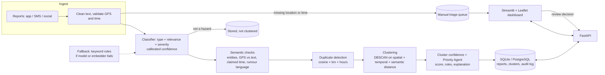
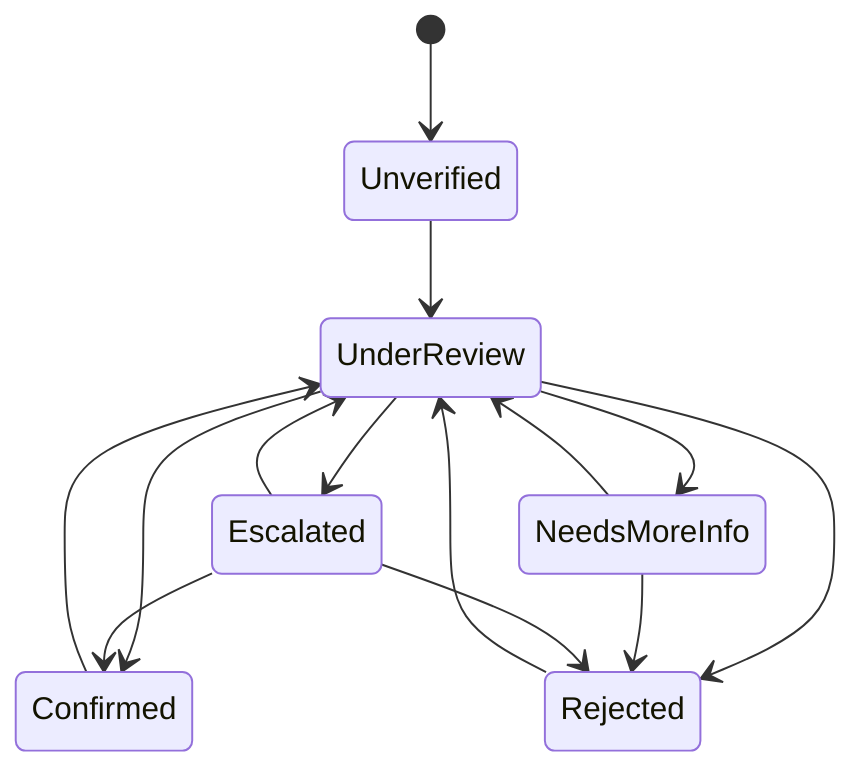

# Architecture

## Data flow
1. **Ingest** - `POST /reports` (or the seeder) cleans text, nulls invalid GPS, parses time. Empty text → HTTP 422.
2. **Triage** - no usable location or no timestamp ⇒ `in_triage`; never clustered, shown in the triage tab.
3. **Classify** - type probabilities (8 classes), `p_hazard = 1 − P(not_hazard)`, severity, confidence = probability of the predicted hazard type (sigmoid-calibrated). If the model or embedder throws, a keyword classifier takes over, the response carries a warning and confidence is capped at 0.6.
4. **Semantic checks** - gazetteer entity extraction; contradictions: text place vs GPS (> 150 km), location field vs GPS, several distant places, claimed time (year/"yesterday"/"N hours ago") vs timestamp; rumour lexicon.
5. **Duplicates** - pair is a duplicate only if cosine ≥ 0.95 **and** ≤ 2 km **and** ≤ 3 h; pairs missing GPS/time are never matched.
6. **Clustering** - combined distance `sqrt((km/15)² + (h/12)² + (d_sem/0.6)²)`, `d_sem = ½(1−cos) + ½·TV(type distributions)`; DBSCAN(eps=1, min_samples=2). Noise points become single-report clusters (never dropped). Output separates **`n_reports`**, **`n_unique_reports`** (after collapsing duplicate components) and the global count of distinct incidents.
7. **Cluster confidence** - weighted mean classifier confidence, type agreement, volume of *distinct* reports, source credibility; penalties for contradictions and rumour language; a cluster with one distinct report is capped at 0.45. `< 0.5` ⇒ label **unconfirmed**.
8. **Priority Agent** - weighted factors (severity .30, volume .20, confidence .20, source credibility .10, recency .10, population exposure .10) → Critical ≥ .70, High ≥ .50, Medium ≥ .30, else Low; rules R1-R3 raise/cap; returns the factor table and a sentence.
9. **Review** - human moves a cluster through the state machine; each move is written to the audit log (reviewer, time, notes). Re-clustering keeps cluster ids (Jaccard ≥ 0.4) and review state, and flags `changed_since_review` if new evidence joined.

## Review state machine

(States are `Unverified, Under Review, Confirmed, Rejected, Escalated, Needs More Info`; an invalid transition returns HTTP 409.)

## REST API
| endpoint | purpose |
|---|---|
| `GET /health` | status, classifier in use, `degraded` if on the keyword fallback |
| `POST /reports` | ingest one report → queue (`clustered` / `triage` / `not_relevant`), warnings |
| `GET /reports?triage=&cluster_id=&limit=&offset=` | list reports (triage queue = `triage=true`) |
| `GET /clusters?hazard_type=&priority=&status=&since=&until=&min_unique=` | filtered clusters (comma-separated lists) |
| `GET /clusters/{id}` | full evidence: members, confidence reasons, contradictions, priority explanation, audit log |
| `POST /clusters/{id}/review` | `{state, reviewer, notes}` → new state (409 if illegal) |
| `POST /recluster` | recompute clusters (e.g. after bulk loading) |
| `GET /metrics` | live counters + offline evaluation JSON |

Interactive docs: `http://localhost:8000/docs`.

## Components and independent entry points
| component | CLI | tests |
|---|---|---|
| data | `python -m src.data.generate_data / clean_data / validate_data` | `tests/test_data.py` |
| classification | `python -m src.classification.cli train / predict "text"` | `tests/test_classification.py` |
| semantic | `python -m src.semantic.duplicates` | `tests/test_semantic.py` |
| clustering | `python -m src.clustering.cli --algo dbscan\|hdbscan\|baseline` | `tests/test_clustering.py` |
| priority | `python -m src.priority.cli` | `tests/test_priority.py` |
| pipeline | `python -m src.pipeline --split test` | `tests/test_pipeline.py` |
| evaluation | `python -m src.evaluation.evaluate` | (produces `/reports`) |
| API | `uvicorn src.api.main:app` | `tests/test_api.py` |
